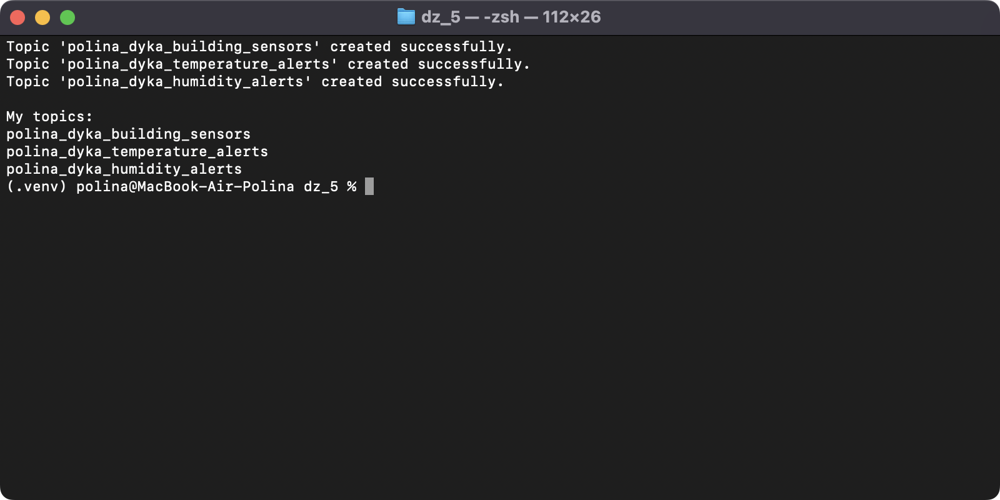
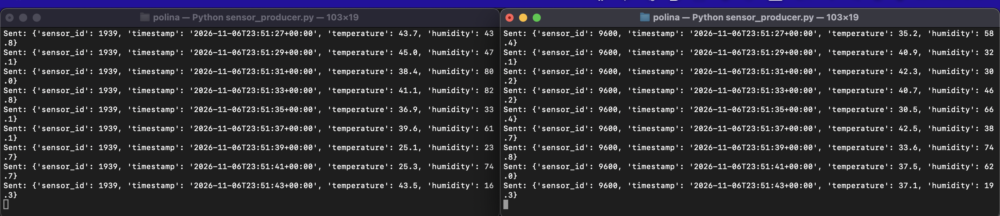
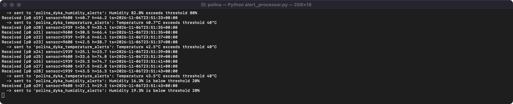
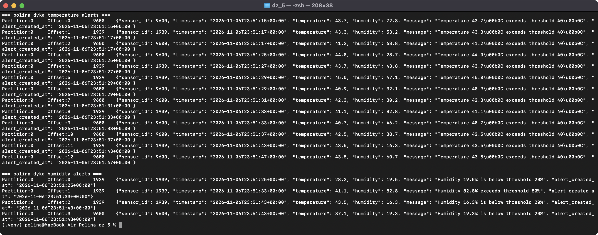
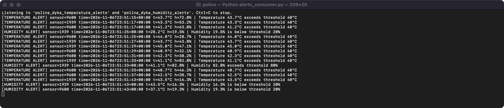

# goit-de-hw-05 — Apache Kafka

Імітація IoT-моніторингу будівель: датчики надсилають температуру й вологість у Kafka, обробник фільтрує показники за порогами й надсилає сповіщення в окремі топіки, а споживач виводить ці сповіщення на екран.

```
sensor_producer.py (×N) ──> polina_dyka_building_sensors ──> alert_processor.py ──┬─> polina_dyka_temperature_alerts ──┐
                                                                                  └─> polina_dyka_humidity_alerts ─────┴─> alerts_consumer.py
```

| Файл | Що робить |
|---|---|
| [configs.py](configs.py) | Параметри підключення, імена топіків (з префіксом `polina_dyka_`), порогові значення |
| [create_topics.py](create_topics.py) | Крок 1: створює 3 топіки і виводить їх список |
| [sensor_producer.py](sensor_producer.py) | Крок 2: один запуск = один датчик зі сталим випадковим ID; кожні 2 с надсилає `sensor_id`, `timestamp`, `temperature` (25–45), `humidity` (15–85) |
| [alert_processor.py](alert_processor.py) | Кроки 3–4: читає `building_sensors`; якщо t > 40 °C — сповіщення в `temperature_alerts`; якщо h > 80 % або h < 20 % — у `humidity_alerts` |
| [alerts_consumer.py](alerts_consumer.py) | Крок 5: підписаний на обидва топіки сповіщень і виводить їх на екран |

Кожне сповіщення містить ID датчика, обидва показники, час вимірювання, повідомлення про порушення порогу й час створення сповіщення. Повідомлення серіалізуються в JSON, ключ — `sensor_id`, тому показники одного датчика потрапляють в одну партицію і зберігають порядок.

## Запуск

Python 3.13, `kafka-python` 2.2.15. Локальний брокер Kafka 3.9 (KRaft, один вузол) піднімається з [docker-compose.yml](docker-compose.yml):

```bash
docker compose up -d
python -m venv .venv && source .venv/bin/activate
pip install -r requirements.txt
python create_topics.py
```

Далі в окремих терміналах:

```bash
python alerts_consumer.py
python alert_processor.py
python sensor_producer.py   # у 2+ терміналах — це 2+ датчики
```

Для віддаленого кластера задайте `KAFKA_BOOTSTRAP_SERVERS`, `KAFKA_USERNAME`, `KAFKA_PASSWORD` (SASL_PLAINTEXT / PLAIN).

## Скриншоти

### 1. Створені топіки

Вивід `[print(topic) for topic in admin_client.list_topics() if MY_NAME in topic]`:



### 2. Генерація даних двома датчиками одночасно

Два запуски `sensor_producer.py` з різними ID датчиків пишуть у `polina_dyka_building_sensors` паралельно:



### 3. Отримання й фільтрація даних

`alert_processor.py` читає кожне повідомлення (партиція, offset, показники) і відбирає ті, що виходять за пороги. Під кожним відібраним повідомленням рядок `-> sent to '...'` показує, у який топік пішло сповіщення. Повідомлення без порушень (наприклад, h = 80.0 — не більше 80) пропускаються:



### 4. Відфільтровані дані в топіках сповіщень

Вміст обох топіків, прочитаний безпосередньо з брокера стандартною утилітою Kafka (ключ — `sensor_id`, значення — JSON сповіщення):

```bash
docker exec kafka /opt/kafka/bin/kafka-console-consumer.sh --bootstrap-server localhost:9092 \
  --topic polina_dyka_temperature_alerts --from-beginning --timeout-ms 4000 \
  --property print.partition=true --property print.offset=true --property print.key=true
```



### 5. Читання сповіщень

`alerts_consumer.py` виводить сповіщення з обох топіків:


